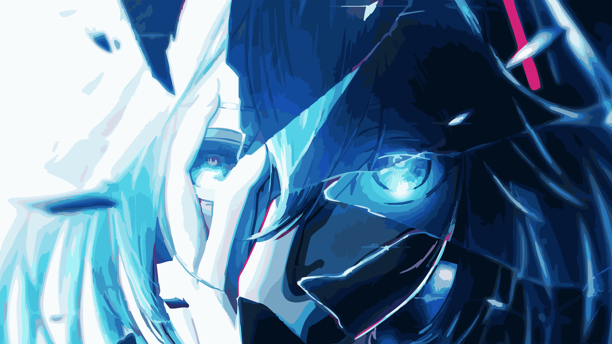
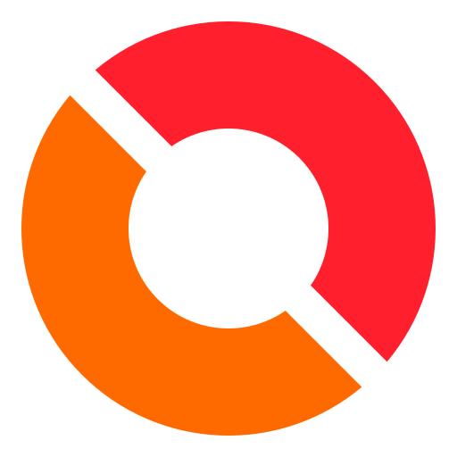
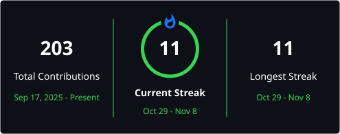
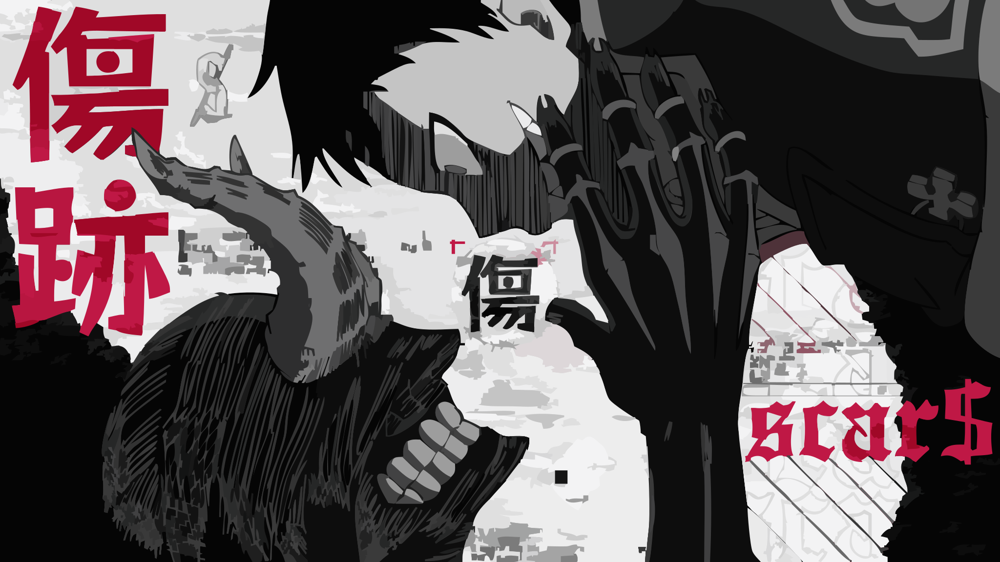
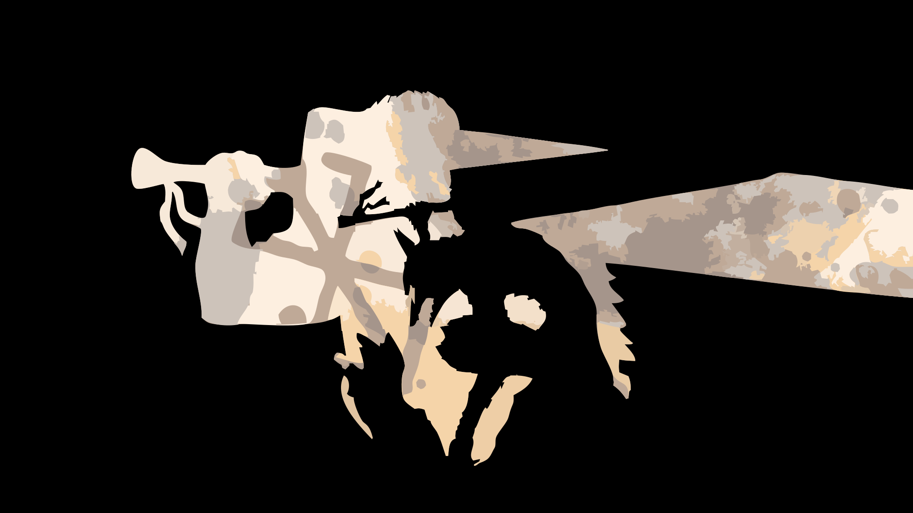

  

<h1 align = "center" > About Me </h1>

  

<h1 align="center">Introduction</h1>

  Hello, I'm Koe (real name Anish Dutta) from Northeast Assam, India. 
  I'm currently working on OredLab, an AI project built from scratch and trained by me and my friends.
  I'm currently pursuing an MSc in Microelectronics and Advanced Communication.
I'm learning HTML, CSS, Python, and Machine Learning.
My interests include Machine Learning, Astronomy, Processor Design, and cars.
  And uhmm IDK nothing really interesting about me 

<h1 align="center">Projects</h1>

  
   
  <b><a href="https://oredlab.com">OredLab</a></b>
   
  An AI built from scratch and trained with friends.
  Everything Ored is built around: simple, private and yours.
  Want to help us ? go to the repository and contribute.

<table>
  <tr>
    <th align="center">Feature</th>
    <th align="center">Details</th>
  </tr>
  <tr>
    <td align="center">🧱 <b>Built from scratch</b></td>
    <td align="center">Our own model, not a wrapper around someone else's</td>
  </tr>
  <tr>
    <td align="center">⬇️ <b>Free local download</b></td>
    <td align="center">Download Ored and keep it on your own PC</td>
  </tr>
  <tr>
    <td align="center">💻 <b>Local inference</b></td>
    <td align="center">Runs on your machine, no cloud AI services</td>
  </tr>
  <tr>
    <td align="center">🧠 <b>Training and checkpoints</b></td>
    <td align="center">Currently in training, checkpoints shared when stable</td>
  </tr>
  <tr>
    <td align="center">🔓 <b>Open development</b></td>
    <td align="center">Public repo and an open roadmap</td>
  </tr>
  <tr>
    <td align="center">🔒 <b>Privacy and independence</b></td>
    <td align="center">Your prompts stay on your machine, no accounts or API keys</td>
  </tr>
</table>

<h1 align="center">Tech Stack</h1>

  
  
  
  
  
  

<h1 align="center">GitHub Stats</h1>

  
  
  

<h1 align="center">Contribution Streak</h1>

  

<h1 align="center">Contribution Snake</h1>

  <picture>
    <source media="(prefers-color-scheme: dark)" srcset="https://raw.githubusercontent.com/Koe458-ui/koe458-ui/output/github-snake-dark.svg" />
    <source media="(prefers-color-scheme: light)" srcset="https://raw.githubusercontent.com/Koe458-ui/koe458-ui/output/github-snake.svg" />
    
  </picture>

<h1 align="center">Connect</h1>

  
  
  
  

<h1 align="center">Ontro</h1>

  

  

  

